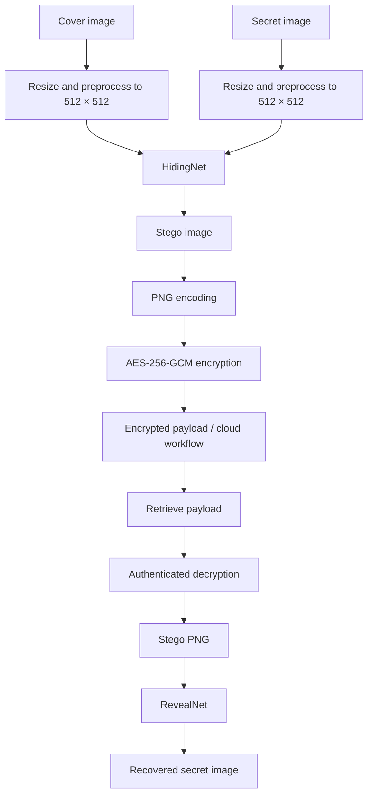
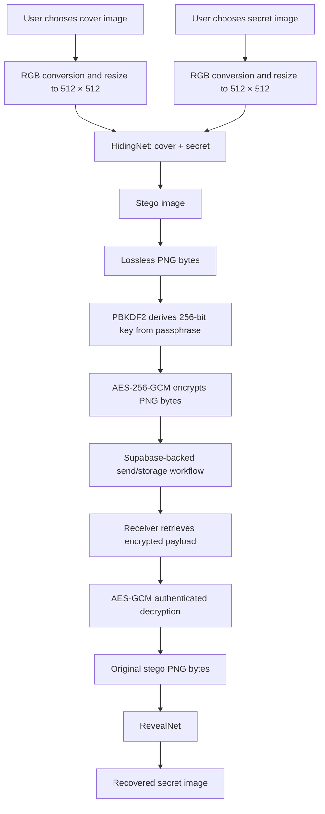

<div align="center">

# 🔐 Deep-Stego Secure V2
### Hide an image inside another. Encrypt the result. Recover it when needed.

**AI-powered image steganography · AES-256-GCM · PyTorch · Streamlit · Supabase**

<p>
  <a href="https://github.com/PradhyumnJadhao/deep-stego-secure-v2"></a>
  <a href="https://huggingface.co/PradhyumnJ/deep-stego-secure-v2-models"></a>
  
  
  
  
</p>

*A web-based image-hiding workflow that combines neural steganography with authenticated encryption and cloud-backed image storage.*

</div>

---

## ✨ Overview

**Deep-Stego Secure V2** is an image steganography application designed to conceal a secret image inside a cover image. A trained neural network produces a stego image that visually resembles the cover; a paired reveal network attempts to reconstruct the hidden image. AES-256-GCM adds confidentiality and integrity protection to the stego-image file, while Supabase supports the application's cloud-backed workflow.

The V2 deployment processes images at **512 × 512 pixels**. Model weights are hosted separately on Hugging Face, keeping large checkpoint files out of the Git repository.

> **Important:** Steganography and encryption solve different problems. Neural image hiding is not a cryptographic guarantee, and this project has not been independently audited or proven resistant to steganalysis.

## 🚀 Highlights

- **512 × 512 image processing** in the deployed app.
- **Paired neural networks:** a HidingNet creates the stego image; a RevealNet reconstructs the secret image.
- **AES-256-GCM authenticated encryption** for the stego-image bytes.
- **Supabase integration** for the app's cloud-backed storage/authentication workflow.
- **Streamlit interface** for using the workflow without a separate frontend build.
- **Hugging Face model hosting** for downloading the large pretrained checkpoints at runtime.
- **Image-quality evaluation** using PSNR and SSIM.
- **Separate source and model repositories** so the application source stays lightweight.

## 🧭 How it works



### Encode path

1. The user selects a **cover image** and a **secret image**.
2. The app converts images to RGB and resizes them to **512 × 512**.
3. HidingNet receives both images and generates a stego image.
4. The stego image is serialized as PNG bytes.
5. The PNG bytes are encrypted using AES-256-GCM.
6. The app can use its Supabase-backed workflow to store and retrieve the encrypted image payload.

### Decode path

1. The user retrieves or supplies the encrypted payload through the app's workflow.
2. AES-256-GCM authenticates and decrypts the payload.
3. The original stego PNG is reconstructed.
4. RevealNet processes the stego image and predicts the hidden image.
5. The recovered image and available quality metrics are displayed.

**Keep the image lossless:** the stego image should remain a PNG. JPEG conversion, screenshots, or social-media re-compression can change pixel values and degrade secret recovery.

## 🧠 Model design

The application uses a **paired hiding/reveal network design** implemented with PyTorch.

| Component | Responsibility |
|---|---|
| `HidingNet` | Takes the cover and secret images as input and produces a stego image. |
| `RevealNet` | Takes the stego image and predicts the hidden secret image. |
| Preprocessing | Converts images to RGB, resizes them to the app's configured input dimensions, and converts them to tensors. |
| Postprocessing | Converts model outputs back into displayable images. |
| Checkpoints | Store the trained parameters used by the application at inference time. |

The model weights currently used by the V2 app are hosted in the [Deep-Stego Secure V2 Hugging Face model repository](https://huggingface.co/PradhyumnJ/deep-stego-secure-v2-models).

### Model files

The app downloads the deployed checkpoints from Hugging Face rather than requiring them to be committed to Git:

- `netH_epoch_73,sumloss=0.000447,Hloss=0.000258.pth` — hiding network checkpoint.
- `netR_epoch_73,sumloss=0.000447,Rloss=0.000252.pth` — reveal network checkpoint.

These are paired model weights. Use the corresponding hiding and reveal checkpoints together.

> The separate experimental training utilities in this project include legacy and V2 model definitions. Do not assume that every checkpoint in the training guide is the same architecture as the checkpoints currently used by the deployed app. Always load checkpoints with the matching architecture and verify inference before swapping weights.

## 📊 512 × 512 evaluation snapshot

A four-image inference check recorded the following image-quality results:

| Comparison | PSNR | SSIM |
|---|---:|---:|
| Cover image vs. stego image | **40.17 dB** | **0.9990** |
| Secret image vs. recovered image | **43.63 dB** | **0.9996** |

These figures are a **small test snapshot**, not a large held-out benchmark or a guarantee for every image. PSNR and SSIM measure image similarity; they do not measure encryption strength, undetectability, or resistance to steganalysis. Results can vary with the input images and evaluation implementation.

### Metrics in brief

- **PSNR (Peak Signal-to-Noise Ratio):** compares pixel-level reconstruction error; higher values generally indicate greater similarity.
- **SSIM (Structural Similarity Index):** compares luminance, contrast, and structure; values closer to `1` generally indicate greater similarity.

For meaningful comparisons, use the same test pairs, preprocessing, output path, and metric implementation for every model version.

## 🏗️ System architecture

```text
Browser
  │
  ▼
Streamlit application (app.py)
  ├── Image preprocessing and display
  ├── PyTorch HidingNet / RevealNet inference
  ├── AES-256-GCM encryption utilities
  ├── Supabase client and cloud workflow
  └── Hugging Face checkpoint download
          │
          ├── Hugging Face model repository
          │     ├── HidingNet checkpoint
          │     └── RevealNet checkpoint
          │
          └── Supabase
                └── Configured cloud storage/authentication resources
```

### Deployment components

- **GitHub:** application source code and dependency manifest.
- **Hugging Face Hub:** large model checkpoints.
- **Streamlit Community Cloud:** deployed web application.
- **Supabase:** cloud-backed storage/authentication functionality configured for the app.

The exact Supabase tables, bucket names, policies, and authentication settings depend on the project's Supabase configuration; configure them to match the application code and your own Supabase project.

## 🧰 Technology stack

| Area | Technology |
|---|---|
| Language | Python |
| Deep learning | PyTorch |
| Image handling | Pillow, NumPy |
| Image-quality metrics | scikit-image |
| Encryption | `cryptography` — AES-GCM |
| Web interface | Streamlit |
| Cloud data/storage | Supabase |
| Model distribution | Hugging Face Hub (`huggingface_hub`) |
| Hosting | Streamlit Community Cloud |
| Version control | Git and GitHub |

## 📁 Repository layout

The main application repository is:

[`PradhyumnJadhao/deep-stego-secure-v2`](https://github.com/PradhyumnJadhao/deep-stego-secure-v2)

A representative layout is:

```text
deep-stego-secure-v2/
├── app.py                  # Streamlit application
├── crypto_utils.py         # Image-byte encryption/decryption utilities
├── requirements.txt        # Runtime dependencies
├── models/
│   ├── HidingUNet.py       # Hiding-network implementation
│   └── RevealNet.py        # Reveal-network implementation
├── .gitignore              # Excludes secrets, checkpoints and local artifacts
└── .streamlit/
    └── secrets.toml        # Local secrets; do not commit
```

The model repository is separate:

[`PradhyumnJ/deep-stego-secure-v2-models`](https://huggingface.co/PradhyumnJ/deep-stego-secure-v2-models)

It contains the large `.pth` checkpoints downloaded by the app. Local training/evaluation files, datasets, generated images, and output folders may exist in a development workspace without being part of the deployed Git repository.

## ⚙️ Run locally

### 1. Clone the repository

```bash
git clone https://github.com/PradhyumnJadhao/deep-stego-secure-v2.git
cd deep-stego-secure-v2
```

### 2. Create and activate a virtual environment

**Windows PowerShell**

```powershell
python -m venv .venv
.\.venv\Scripts\Activate.ps1
```

If PowerShell blocks activation, use the Python executable inside `.venv` directly or follow your system's approved virtual-environment policy.

**macOS / Linux**

```bash
python3 -m venv .venv
source .venv/bin/activate
```

### 3. Install dependencies

```bash
python -m pip install --upgrade pip
pip install -r requirements.txt
```

PyTorch installation requirements can vary by operating system and hardware. For GPU acceleration, install a PyTorch build compatible with your CUDA environment; CPU inference may be slower.

### 4. Configure secrets

Create `.streamlit/secrets.toml` locally. Use the exact secret names expected by `app.py`; the current app reads `SUPA_URL` and `SUPA_KEY`.

```toml
SUPA_URL = "https://YOUR-PROJECT.supabase.co"
SUPA_KEY = "YOUR-SUPABASE-KEY"
```

Replace the placeholders with values from your own Supabase project. **Never commit this file, publish credentials, or paste secrets into issues or screenshots.** The repository's `.gitignore` is intended to exclude `.streamlit/`.

If your deployment uses environment variables instead, configure the same values in the hosting provider's secret/settings panel.

### 5. Start the app

```bash
streamlit run app.py
```

Streamlit will print a local URL, usually `http://localhost:8501`.

On first model load, the app downloads the configured checkpoints from the Hugging Face model repository. An internet connection and access to the model repository are required.

## ☁️ Deployment notes

### Streamlit Community Cloud

1. Push the application source to GitHub.
2. Create or select the Streamlit Community Cloud app and point it to the repository and `app.py`.
3. Add the required Supabase secrets in the app's **Secrets** settings.
4. Ensure `requirements.txt` includes all runtime dependencies.
5. Keep the Hugging Face model repository ID and filenames consistent with the checkpoint-loading code.
6. Open the deployed app and test a complete encode/decode cycle after every model or preprocessing change.

### Hugging Face model repository

The app uses `hf_hub_download` to fetch model files at runtime. Keep the repository ID and filenames in `app.py` aligned with the actual files in the model repository. Model files are intentionally kept out of GitHub because of their size.

## 🔐 Security model and limitations

### What the security layers do

- **AES-256-GCM:** provides authenticated encryption for the serialized stego-image payload when implemented and used correctly. Decryption fails if the ciphertext or authentication tag is invalid.
- **Neural steganography:** attempts to make the stego image resemble the cover while encoding information in its image content.
- **Supabase controls:** access depends on the configured authentication flow, storage policies, and Row Level Security (RLS) rules.

### Important limitations

- **No claim of undetectability:** no steganalysis benchmark is provided here, so the system should not be described as invisible, unbreakable, or proven undetectable.
- **Passphrase/key management matters:** AES-GCM security depends on correct key derivation, nonce uniqueness, secret handling, and implementation details. Use a strong secret and never reuse a nonce with the same AES-GCM key.
- **Lossy transformations are unsafe:** JPEG conversion, resizing after encoding, screenshots, and platform recompression may damage the hidden image.
- **Image dimensions are standardized:** the app resizes inputs to 512 × 512, so original dimensions and aspect ratio may not be preserved.
- **Model output is approximate:** RevealNet predicts the secret; recovery is not guaranteed to be pixel-identical to the original secret image.
- **Stored payload compatibility:** hiding and reveal checkpoints should be treated as a matched pair. Replacing the model may affect recovery of previously stored stego images.
- **Not a security audit:** this project is for learning, demonstration, and experimentation. Do not use it as the sole protection for highly sensitive material without an independent security review.

## 🧪 Testing and quality checks

Before publishing a new version, verify:

- [ ] The app starts with secrets configured and no credentials committed.
- [ ] The Hugging Face checkpoints download successfully.
- [ ] Both model checkpoints load without shape/key errors.
- [ ] Inputs are processed at the expected 512 × 512 dimensions.
- [ ] Encode → PNG serialization → AES-GCM encrypt → decrypt → RevealNet decode completes.
- [ ] An altered ciphertext or invalid key is rejected by authenticated decryption.
- [ ] PSNR and SSIM are computed against the correct image pairs.
- [ ] The recovered image is visually inspected, not judged only by metrics.
- [ ] The test is repeated on several different image pairs.
- [ ] The deployed Streamlit version behaves the same as the tested local version.

The repository also includes model development and evaluation utilities in the project workspace, such as `stego_models.py`, `train_stego.py`, `evaluate.py`, and `test_regression.py`. Consult `UPGRADE_GUIDE.md` before using those utilities to train or replace deployed checkpoints. Training settings, architectures, and checkpoints must match.

## 🧭 Technical Deep Dive & Project Guide

This section brings together the system overview, architecture, core concepts, evaluation notes, and common technical questions in one place.

### Project overview in 30 seconds

> **Deep-Stego Secure V2 is a web application for sharing a secret image by hiding it inside a cover image.** A PyTorch HidingNet takes the cover and secret images and creates a stego image that should look similar to the cover. The app serializes that image as PNG and encrypts the PNG bytes using AES-256-GCM with a key derived from a user passphrase through PBKDF2-HMAC-SHA256. Streamlit provides the interface, Supabase supports account and message/storage workflows, and the paired RevealNet reconstructs the hidden image after the payload is retrieved and decrypted. The deployed app processes images at 512 × 512 pixels, while large model checkpoints are hosted separately on Hugging Face.

Use this as a starting script, not as a claim that the system is formally audited or impossible to detect.

### The project in one diagram



### Important concepts to explain clearly

| Term | Plain-English explanation | Why it is used here |
|---|---|---|
| **Cover image** | The ordinary-looking image used as the carrier. | It is the visual base for the stego output. |
| **Secret image** | The image the sender wants to conceal. | It is the content RevealNet tries to reconstruct. |
| **Stego image** | The output image carrying hidden information. | It is what the sender can share or store. |
| **HidingNet** | A neural network that receives both cover and secret images. | It learns how to encode the secret into the cover's image content. |
| **RevealNet** | A paired neural network that receives the stego image. | It predicts the hidden image. |
| **Steganography** | Concealing the existence of a message in another object. | The stego image is intended to resemble the cover. |
| **Encryption** | Transforming data into ciphertext that requires a key to recover. | AES-GCM protects the serialized stego image. |
| **AES-256-GCM** | AES with a 256-bit key in Galois/Counter Mode. | Provides confidentiality and authenticated integrity when used correctly. |
| **PBKDF2-HMAC-SHA256** | A password-based key derivation function that applies repeated HMAC-SHA256 operations with a salt. | Makes passphrase guessing more computationally expensive than a single hash. |
| **Salt** | Random input used during key derivation. | The receiver needs the same salt to derive the same key. It is not a secret. |
| **Nonce** | A value supplied to AES-GCM for an encryption operation. | It must be unique for each encryption under the same key. It is not a password. |
| **PNG** | A lossless image format. | Preserves pixel values needed by the reveal model better than lossy formats. |
| **PSNR** | A pixel-error-based image similarity metric, reported in decibels. | Helps measure how much the stego image differs from the cover, or the recovered image from the secret. |
| **SSIM** | A structural similarity metric, generally ranging from -1 to 1 depending on implementation; practical image comparisons often lie between 0 and 1. | Estimates similarity in luminance, contrast, and structure. |
| **Checkpoint** | A file containing trained model parameters. | Allows the app to run inference without training the networks each time. |

### Why use both steganography and encryption?

They address different questions:

- **Steganography:** “Can the image carry hidden content while looking similar to the cover?”
- **Encryption:** “If someone obtains the encrypted payload, can they recover its bytes without the correct passphrase-derived key?”

Neither replaces the other. A stego image may be discovered by steganalysis; encryption protects the encrypted file's contents. Conversely, encryption alone does not hide the fact that ciphertext exists.

### Why AES-256-GCM?

- AES uses a **256-bit key** in this implementation.
- GCM is an authenticated-encryption mode: it protects confidentiality and detects ciphertext/tag tampering.
- The implementation derives a key from the passphrase using **PBKDF2-HMAC-SHA256 with 480,000 iterations** and a random 16-byte salt.
- A random 12-byte nonce is generated for encryption.
- The salt and nonce are stored with the encrypted payload because they are required for decryption; they do not need to be secret.
- If the passphrase is wrong or the ciphertext has been modified, authenticated decryption should fail rather than return trusted plaintext.

**Security note:** Say “AES-256-GCM authenticated encryption,” not “unbreakable encryption.” Real security also depends on passphrase strength, nonce handling, secret storage, access policies, and implementation.

### Why keep the model checkpoints on Hugging Face?

The hiding checkpoint is large, so committing it to the source repository would make Git history and cloning unnecessarily heavy. The app downloads the required checkpoint files from the Hugging Face model repository at runtime. GitHub contains application source; Hugging Face contains model artifacts.

This separation also means the app needs network access and the correct repository ID/filenames on a cold start. A checkpoint must match the architecture expected by its loader.

### What do PSNR and SSIM tell us?

Two comparisons matter:

1. **Cover vs. stego:** measures whether the carrier image changed visibly.
2. **Secret vs. recovered:** measures how faithfully the hidden image was reconstructed.

A high cover–stego score is desirable because the stego image should remain similar to the cover. A high secret–recovered score is desirable because the recovered output should resemble the original secret.

#### Recorded 512 × 512 test snapshot

| Comparison | PSNR | SSIM |
|---|---:|---:|
| Cover → stego | 40.17 dB | 0.9990 |
| Secret → recovered | 43.63 dB | 0.9996 |

These numbers were recorded in a **four-image inference check**. They are useful as a project-specific test snapshot, not a statistically strong benchmark, a guarantee across all images, or evidence of resistance to steganalysis. State the sample size whenever presenting them.

### What is the 512 × 512 detail?

The deployed app's preprocessing uses `IMG_SIZE = 512` and resizes the input images to `(512, 512)` before model inference. The current workflow therefore processes a standardized square image size. This does **not** preserve each input's original aspect ratio or dimensions.

The neural networks are used for inference at that size. The separate training utilities have their own defaults and experimental architectures; the presence of those utilities does not mean the deployed checkpoints were necessarily trained from scratch at 512 × 512. Be precise: **the deployed app processes inputs at 512 × 512 and this inference path was tested on four image pairs.**

### What is the role of Supabase?

Supabase supports the cloud-backed user and messaging workflow. In this app:

- Users can create an account and sign in.
- A profile includes a generated `Stego-ID` in the `DSS-XXXXXX` style.
- A sender can search for a recipient by username or Stego-ID.
- Encrypted stego-image payloads are stored through Supabase Storage, and message metadata supports the inbox/sent workflow.
- The receiver enters the passphrase to decrypt the payload before the reveal model runs.

The exact protection of user data depends on Supabase Auth configuration, Storage policies, and Row Level Security. Do not claim that access is secure merely because Supabase is used; policies must be configured correctly.

### Common technical questions and concise answers

**1. What problem does the project solve?**  
It demonstrates a workflow for concealing a secret image inside a visually similar carrier image and protecting the resulting stego-image file with authenticated encryption before sharing.

**2. Why are there two neural networks?**  
HidingNet learns the transformation from cover-plus-secret to stego image. RevealNet is trained as its paired decoder to reconstruct the secret from the stego image.

**3. Is the secret image stored directly in the stego image?**  
The network encodes information about the secret into the stego image's pixel content. RevealNet learns to reconstruct an approximation; it is not a lossless file container for the original secret.

**4. Why not just encrypt the secret image?**  
Encryption protects content but does not conceal the presence of an encrypted payload. Steganography aims to make the payload less obvious; encryption adds a separate confidentiality and integrity layer.

**5. What happens if someone changes the encrypted bytes?**  
AES-GCM authentication should fail during decryption if ciphertext or the authentication tag is modified.

**6. Why use PNG rather than JPEG?**  
PNG is lossless. JPEG compression changes pixel values, which can damage the signal the reveal network relies on.

**7. What happens if the receiver uses the wrong passphrase?**  
Key derivation produces the wrong key, so AES-GCM authentication fails and the app cannot obtain the original stego PNG bytes.

**8. What are PSNR and SSIM?**  
PSNR quantifies pixel-level error in decibels; SSIM compares structural image similarity. We use cover–stego metrics and secret–recovered metrics for different goals.

**9. Does SSIM of 0.999 mean the image is undetectable?**  
No. SSIM measures image similarity, not detectability. Steganalysis requires separate experiments with defined detection methods and datasets.

**10. Why use PBKDF2?**  
A user passphrase is not necessarily a uniformly random AES key. PBKDF2 derives a 256-bit key while making each password guess more expensive through repeated HMAC operations and a salt.

**11. What is the salt, and can it be public?**  
The salt is a random value used to derive the same key during decryption. It can be stored alongside the ciphertext; it is not a replacement for a strong passphrase.

**12. Why store checkpoints separately from GitHub?**  
Model weights can be large. Hosting them on Hugging Face keeps source control lighter and lets the app download them when required.

**13. What happens if the model checkpoints are changed?**  
HidingNet and RevealNet should be treated as a matched pair. Replacing one or both can change output quality and may break compatibility with previously created stego images.

**14. What is the main limitation?**  
Recovery quality is approximate and may vary by image. The app resizes inputs to a square 512 × 512 resolution, the hidden content is not guaranteed to survive lossy transformations, and the system has not been independently audited or benchmarked against steganalysis.

**15. What would you improve next?**  
Run a reproducible held-out evaluation over many image pairs, report mean and variation for both metric families, benchmark latency and memory, add automated end-to-end tests, validate Supabase access policies, and evaluate robustness and steganalysis with clearly defined threat models.

### A technically honest 60-second walkthrough

1. **Input:** choose a cover image and a secret image.
2. **Preprocessing:** convert both to RGB and resize them to 512 × 512.
3. **Hiding:** HidingNet receives both tensors and produces the stego image.
4. **Serialization:** convert the stego output into PNG bytes.
5. **Encryption:** derive a 256-bit key from the passphrase using PBKDF2-HMAC-SHA256, then encrypt the PNG bytes using AES-GCM with a random nonce.
6. **Sharing:** use the app's Supabase-backed send/storage flow, or download the stego PNG for manual sharing.
7. **Recovery:** retrieve and authenticate-decrypt the encrypted payload with the correct passphrase.
8. **Reveal:** feed the resulting stego image into RevealNet and display/download the recovered secret image.

### Do not overclaim these points

- Do not call the system **“unbreakable,” “invisible,” or “military-grade.”**
- Do not say PSNR/SSIM prove cryptographic security or steganalysis resistance.
- Do not imply that the secret is recovered pixel-for-pixel.
- Do not say the training utilities' default `--image_size 128` means the live app is still 128 × 128; the deployed app's current `IMG_SIZE` is 512. Also do not claim the current deployed checkpoints were trained at 512 × 512 unless you have the corresponding training record.
- Do not claim Supabase policies are secure without checking the actual project configuration.
- Do not share secrets, passphrases, service-role keys, or `.streamlit/secrets.toml` in the repository.

## 🧠 Quick project recap

For a quick refresher, keep these six points in mind:

1. **Goal:** hide a secret image inside a cover image and reconstruct it later.
2. **Neural path:** `HidingNet(cover, secret) → stego`; `RevealNet(stego) → recovered secret`.
3. **Crypto path:** PNG bytes → PBKDF2-derived AES-256 key → AES-GCM ciphertext; the receiver decrypts before revealing.
4. **Resolution:** the deployed app preprocesses images to 512 × 512.
5. **Evaluation:** the recorded four-image check showed 40.17 dB / 0.9990 for cover–stego and 43.63 dB / 0.9996 for secret–recovered; do not present this as a large benchmark.
6. **Limitations:** lossless PNG matters; image recovery is approximate; steganalysis resistance and production-grade security are not established.

## 🛣️ Potential future improvements

- Broader, reproducible testing on a held-out image set.
- Benchmark inference time, peak memory, and model download latency.
- Add automated tests for encryption/decryption failures and malformed inputs.
- Document the exact key derivation and nonce-handling design.
- Evaluate robustness to common image transformations.
- Evaluate steganalysis resistance using a defined threat model and suitable baselines.
- Improve model/version metadata so stored payloads can be decoded with the correct checkpoint pair.
- Add an explicit model-card-style report covering training data, limitations, and evaluation methodology.

These are possible improvements, not features claimed to be implemented already.

## 👨‍💻 Author

**Pradhyumn Jadhao**

- GitHub: [@PradhyumnJadhao](https://github.com/PradhyumnJadhao)
- Application source: [deep-stego-secure-v2](https://github.com/PradhyumnJadhao/deep-stego-secure-v2)
- Model weights: [deep-stego-secure-v2-models](https://huggingface.co/PradhyumnJ/deep-stego-secure-v2-models)


---

<div align="center">

**Built with PyTorch, Streamlit, AES-GCM, and Hugging Face.**

*Secure image sharing is a system property: model quality, cryptographic implementation, key management, storage permissions, and user workflow all matter.*

</div>
